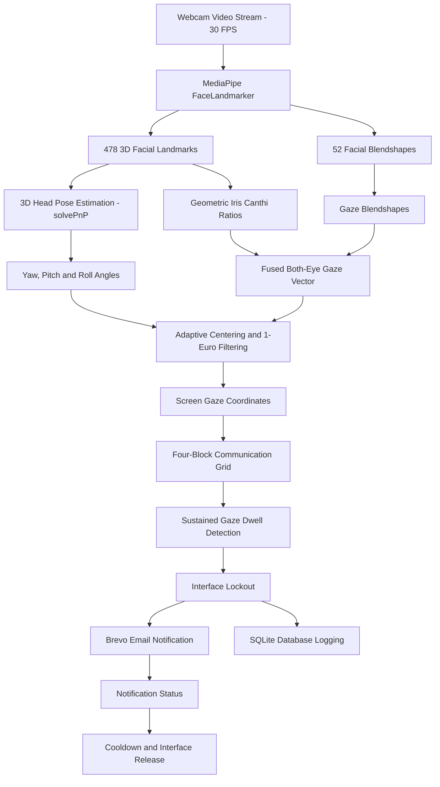

# AI-Vision-Based Communication Assistance for Paralyzed Individuals

**Major Project:** Hands-Free Eye Gaze and Head Movement Communication System

A vision-based assistive communication system that enables paralyzed individuals to communicate their basic needs through eye gaze and head movement. The system features both-eye tracking, 5-point calibration, a 4-block communication interface, sustained gaze selection, a safety lockout mechanism, and automated caregiver notifications through the Brevo Transactional Email REST API.

---

## 1. Project Synopsis and Motivation

Paralyzed individuals who cannot speak or use their hands often face significant difficulties expressing basic physiological needs, pain, and emergencies. Traditional assistive communication technologies may require physical interaction, lengthy calibration procedures, or frequent recalibration when a patient's posture changes.

This project aims to address these challenges through a webcam-based communication system.

### Key Features

1. **Both-Eye Tracking and Fusion:** Simultaneously tracks the left and right irises using MediaPipe FaceLandmarker, which provides 478 facial landmarks and 52 blendshape coefficients. Canthal axis projection and 3D head pose estimation using `solvePnP` are combined to improve gaze estimation and reduce unwanted movement effects.

2. **5-Point Calibration with LOBO-CV:** Implements a five-point calibration process with Leave-One-Box-Out Cross-Validation (LOBO-CV). It evaluates model performance using Mean Absolute Error (MAE) and Root Mean Square Error (RMSE) in pixels. An adaptive resting baseline is used when calibration is skipped or interrupted.

3. **Four-Block Communication Interface:** Provides four large visual request blocks arranged in a 2x2 grid. The interface includes high-contrast typography, distinct category colors, keyboard shortcuts (1–4), and radial dwell countdown indicators.

4. **Sustained Gaze Selection:** Detects when the user maintains their gaze on a request block for the configured duration. The default dwell time is 3 seconds.

5. **Safety Lockout and Watchdog:** Locks the interface immediately after a request is triggered to prevent duplicate selections. A safety watchdog automatically releases the interface if a background operation exceeds 20 seconds.

6. **Caregiver Notifications and Logging:** Sends HTML-formatted email notifications through the Brevo REST API or operates in offline simulation mode. Request information is stored in an SQLite database, with support for CSV export and caregiver dashboard access.

---

## 2. System Architecture

The system follows a webcam-based processing pipeline that converts facial information into communication requests.



---

## 3. Communication Blocks

The interface contains four primary communication blocks designed to represent common patient requirements.

| Block | Title | Category | Priority | Accent Color | Caregiver Notification |
|---|---|---|---|---|---|
| 1 | Food | Nutrition | MEDIUM | Amber (`#d97706`) | Patient is hungry and requests meal or nourishment assistance. |
| 2 | Water | Hydration | MEDIUM | Blue (`#3b82f6`) | Patient requires drinking water or hydration assistance. |
| 3 | Medicine | Medical Care | HIGH | Emerald (`#10b981`) | Patient requests scheduled medication, pills, or pain relief. |
| 4 | Help | Urgent Care | CRITICAL | Red (`#dc2626`) | Patient urgently requests immediate caregiver presence. |

Each block is designed with large visual targets to make selection easier through eye gaze.

---

## 4. Vision Engine and Five-Point Calibration

### Both-Eye Tracking Architecture

The vision engine uses MediaPipe FaceLandmarker to detect facial landmarks and estimate eye positions.

The tracking architecture includes:

- Independent left-eye and right-eye tracking.
- Iris center estimation with subpixel refinement and radial-symmetry gradient scoring.
- Canthal geometry for estimating gaze direction.
- 3D head pose estimation using OpenCV `solvePnP`.
- Adaptive 1-Euro filtering to reduce gaze jitter while maintaining responsiveness to intentional eye movements.

### Five-Point Calibration

The calibration process uses five screen positions:

| Calibration Point | X Coordinate | Y Coordinate |
|---|---:|---:|
| Top-Right | 0.90 | 0.10 |
| Top-Left | 0.10 | 0.10 |
| Centre | 0.50 | 0.50 |
| Bottom-Right | 0.90 | 0.90 |
| Bottom-Left | 0.10 | 0.90 |

### LOBO-CV Validation

The Leave-One-Box-Out Cross-Validation method evaluates calibration performance.

The process works as follows:

1. Five calibration points are collected.
2. Four points are used to train a regression model.
3. The remaining point is used for validation.
4. The process is repeated until all five points have been held out once.
5. MAE and RMSE are calculated in pixels.

The system supports Ridge Regression, Huber Robust Regression, and Affine Regression models.

If calibration is skipped or interrupted, the system uses adaptive resting baseline tracking.

---

## 5. Lockout Protocol and Watchdog Protection

The lockout mechanism prevents repeated requests and duplicate caregiver notifications.

### Request Selection Process

1. The system continuously monitors the user's gaze position.
2. When the gaze enters a communication block, the dwell countdown begins.
3. A radial countdown indicator displays the selection progress.
4. When the configured dwell duration is reached, the request is triggered.
5. The interface enters the `SENDING_EMAIL` state.
6. All other communication blocks are disabled and visually dimmed.
7. A full-screen overlay displays the notification progress.

### Background Notification

The email notification is dispatched asynchronously through the Brevo Transactional Email REST API.

### Watchdog Protection

A safety watchdog monitors the notification process. If dispatch exceeds 20 seconds, the watchdog releases the interface so that the patient can continue making requests while the background delivery operation completes.

---

## 6. Installation and Execution

### Prerequisites

- Python 3.10 or later.
- Integrated laptop camera or external USB webcam.
- Windows operating system for the provided Windows launcher.
- Internet connection for live Brevo email notifications.

### Installation

Open a terminal and navigate to the project directory:

```bash
cd "C:\Users\Punithurs K\Downloads\Eye Gaze AI"
```

Install the required dependencies:

```bash
pip install -r requirements.txt
```

### Running the Application

The application can be started using the Windows batch launcher:

```bash
run.bat
```

Alternatively, execute:

```bash
python main.py
```

The launcher automatically verifies the MediaPipe FaceLandmarker model at:

```text
models/face_landmarker.task
```

It then starts the Flask server at:

```text
http://127.0.0.1:5000
```

The default browser opens the application interface.

---

## 7. Caregiver Portal and Email Configuration

The application provides a caregiver portal accessible through the Dashboard, Settings, and History navigation links.

### Simulation Mode

Simulation Mode is enabled by default.

- Simulates email dispatch locally.
- Allows testing without Brevo API credentials.
- Records simulated notification activity.

### Live Brevo Configuration

To enable actual email notifications:

1. Create or access a Brevo account.
2. Generate a Brevo API key.
3. Configure a verified sender email address.
4. Enter the caregiver's recipient email address.
5. Open the application Settings page.
6. Enter the required configuration details.
7. Use **Send Test Email Now** to verify connectivity.

The application uses the Brevo Transactional Email REST API to dispatch caregiver notifications.

---

## 8. Database, Audit Logs and Testing

### SQLite Database

The application uses the following database:

```text
paralyzed_assistance.db
```

It stores:

- Patient request history.
- Notification delivery information.
- Request timestamps.
- Delivery latency information.
- System configuration.

### History and CSV Export

The caregiver can access request history through:

```text
/caregiver/history
```

The history section provides access to previously triggered requests and CSV export functionality.

### Request ID Reset

The caregiver portal supports resetting the auto-increment request ID sequence while preserving existing records.

### Testing

Run the calibration and email integration tests using:

```bash
python -m unittest tests_calibration_and_email.py
```

---

## 9. Keyboard Shortcuts and Camera Controls

The application supports keyboard shortcuts for situations where camera-based selection is unavailable or physical input is preferred.

| Key | Action |
|---|---|
| 1 | Food |
| 2 | Water |
| 3 | Medicine |
| 4 | Help |

Pressing any key from 1 to 4 immediately triggers the corresponding request, locks the interface, dispatches the notification, and records the event in SQLite.

### Camera Controls

The System Controls dropdown provides:

- **Turn Off Camera:** Disables webcam tracking.
- **Turn On Camera:** Enables webcam tracking again.
- **HUD View:** Displays the tracking information interface.

---

## 10. Technologies Used

| Technology | Purpose |
|---|---|
| Python | Main application development |
| Flask | Web application and server |
| OpenCV | Image processing and camera access |
| MediaPipe FaceLandmarker | Facial landmark and iris tracking |
| NumPy | Numerical operations |
| Scikit-learn | Regression models and calibration validation |
| SQLite | Request and configuration storage |
| Brevo REST API | Caregiver email notifications |
| HTML, CSS and JavaScript | User interface development |

---

## Project Objective

The primary objective of this project is to develop an accessible, webcam-based communication solution that enables individuals with severe physical limitations to express essential needs through eye gaze and head movement.

By combining computer vision, calibration techniques, an intuitive communication interface, and automated caregiver notifications, the system aims to improve communication accessibility and support timely assistance.

---

**Note:** This project is an assistive communication prototype. It is not a certified medical device or a replacement for continuous clinical supervision or emergency response systems.
