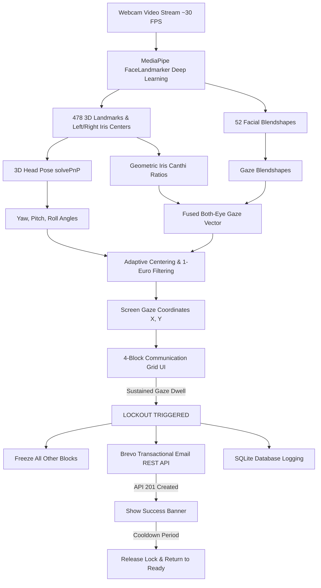

# AI-Vision-Based Communication Assistance for Paralyzed Individuals

> **Major Project**: Hands-Free Eye Gaze & Head Movement Communication System featuring Precision Both-Eye Tracking, 5-Point Calibration (with Leave-One-Box-Out Cross-Validation & Adaptive Baseline Fallback), 4-Block Ergonomic UI Grid, Sustained Gaze Dwell Timing, Strict Lockout Safety Protocol with Watchdog Protection, and Automated Caregiver Notification via **Brevo Transactional Email REST API** (with Offline Simulation Mode).

---

## 📌 1. Project Synopsis & Motivation

Paralyzed individuals who cannot speak or use their hands often face severe difficulty expressing their basic physiological needs, acute pain, and critical emergencies. Traditional assistive communication technologies often require physical contact, calibrate through arduous calibration routines that cause eye fatigue, or fail whenever the patient slightly shifts posture in bed or a wheelchair.

**This system solves these fundamental problems by:**
1. **Precision Both-Eye Tracking & Fusion**: Simultaneously tracks both left and right irises using MediaPipe FaceLandmarker (478 3D landmarks + 52 blendshapes), combining canthal axis projection and 3D head pose estimation (`solvePnP`) to eliminate tremor and micro-saccadic noise.
2. **5-Point Calibration with LOBO-CV & Adaptive Fallback**: Features a 5-point calibration routine with Leave-One-Box-Out Cross-Validation (LOBO-CV) measuring genuine validation Mean Absolute Error (MAE) and RMSE in pixels. If skipped or interrupted, the system seamlessly falls back to intelligent adaptive resting baseline tracking.
3. **4 High-Ergonomics Request Blocks (2x2 Grid)**: Specially designed for paralyzed users with large visual targets, distinct clinical color coding, high-contrast typography, hotkey numbers (1–4), and radial dwell countdown timers.
4. **Sustained Fixation Dwell Timing**: Looking at any of the 4 request blocks for the configured dwell duration (default 3.0s) triggers selection with visual progress and optional audio chimes.
5. **Strict Lockout Safety Protocol & Watchdog**: The moment a request is triggered, **the entire interface locks, freezing all other blocks** to prevent duplicate alerts. A safety watchdog automatically releases the interface after 20s if a background worker exceeds timing limits, ensuring patient safety.
6. **Automated Caregiver Notification & Logging**: Instant HTML-formatted email alerts dispatched via Brevo REST API (or offline Simulation Mode), alongside full SQLite database logging (`paralyzed_assistance.db`), CSV export, and caregiver portal dashboards.

---

## 🏗️ 2. System Architecture



---

## 🧩 3. The 4 Communication Blocks

| Block # | Title | Icon | Category | Priority | Accent Color | Automated Caregiver Message |
| :---: | :---: | :---: | :---: | :---: | :---: | :--- |
| **1** | **Food** | 🍲 | Nutrition | `MEDIUM` | Amber (`#d97706`) | *"Patient is hungry and requests meal or nourishment assistance."* |
| **2** | **Water** | 💧 | Hydration | `MEDIUM` | Blue (`#3b82f6`) | *"Patient requires drinking water or hydration assistance."* |
| **3** | **Medicine** | 💊 | Medical Care | `HIGH` | Emerald (`#10b981`) | *"Patient requests scheduled medication, pills, or pain relief."* |
| **4** | **Help** | 🚨 | Urgent Care | `CRITICAL`| Red (`#dc2626`) | *"CRITICAL ALERT: Patient urgently requests immediate caregiver presence!"* |

---

## 🔬 4. Vision Engine & 5-Point Calibration

### Mandatory Both-Eye Tracking Architecture:
- Tracks left and right eyes independently with subpixel iris refinement and radial-symmetry gradient scoring.
- Incorporates an **Adaptive 1-Euro Filter** with velocity-aware damping to eliminate jitter during steady fixation while preserving instant response during intentional saccades.

### 5-Point Calibration & LOBO-CV Validation:
- Targets: Top-Right (0.90, 0.10), Top-Left (0.10, 0.10), Centre (0.50, 0.50), Bottom-Right (0.90, 0.90), Bottom-Left (0.10, 0.90).
- **LOBO-CV (Leave-One-Box-Out Cross-Validation)**: Trains regression models (Ridge, Huber Robust, Affine) on 4 boxes and evaluates on the held-out 5th box, computing honest Mean Absolute Error (MAE) and RMSE in pixels without artificial accuracy inflation.

---

## 🔒 5. Strict Lockout Protocol & Watchdog

1. **Fixation Detection**: When gaze lands inside any block, a radial countdown ring animates over the configured dwell time.
2. **Lock Engagement**:
   - The interface locks with status `SENDING_EMAIL`.
   - **All other blocks are immediately dimmed and disabled.**
   - A full-screen lockout overlay appears displaying step-by-step progress.
3. **Background Dispatch**: Email is transmitted via Brevo REST API asynchronously without freezing the user interface.
4. **Safety Watchdog**: If a request remains in dispatch for >20s, the watchdog safely unlocks the interface for patient safety while background delivery completes.

---

## 🚀 6. Quick Start & Execution

### Prerequisites
- Python 3.10+ (Verified on Python 3.14)
- Standard USB Webcam or Integrated Laptop Camera

### Installation
```bash
cd "C:\Users\Punithurs K\Downloads\Eye Gaze AI"
pip install -r requirements.txt
```

### Running the System
Double-click `run.bat` or run:
```bash
python main.py
```
*The launcher automatically verifies the MediaPipe FaceLandmarker model (`models/face_landmarker.task`), starts the Flask server on `http://127.0.0.1:5000`, and opens your default browser.*

---

## ⚙️ 7. Caregiver Portal & Email Configuration

Access the Caregiver Portal via the **Dashboard**, **Settings**, or **History** links in the top navigation:
- **Simulation Mode (Default)**: Safely simulates email dispatch locally so you can test without entering API keys.
- **Live Brevo Mode**: Enter your [Brevo API Key](https://app.brevo.com/), verified sender email (`brevo_sender_email`), and caregiver recipient email in **Settings**.
- Click **Send Test Email Now** to verify connectivity.

---

## 📊 8. Database, Audit Logs & Testing

- **SQLite Database (`paralyzed_assistance.db`)**: Permanently records all request logs, delivery latencies, and system configuration.
- **History & CSV Export**: View full historical logs in `/caregiver/history` or click **Export CSV**.
- **Request ID Reset**: Caregivers can reset the auto-increment ID sequence while preserving existing records.
- **Unit & Integration Tests**: Run tests via:
  ```bash
  python -m unittest tests_calibration_and_email.py
  ```

---

## 🔢 9. Keyboard Hotkeys (1–4) & Camera Controls

When the camera is disabled or physical input is preferred:
- **1**: Food
- **2**: Water
- **3**: Medicine
- **4**: Help (Urgent SOS)
- Pressing **1–4** immediately locks the interface, dispatches the alert, and logs to SQLite.
- A **Turn Off Camera** / **Turn On Camera** toggle and **HUD View** button are available in the System Controls dropdown.
